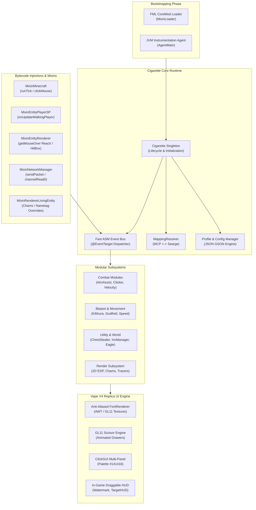
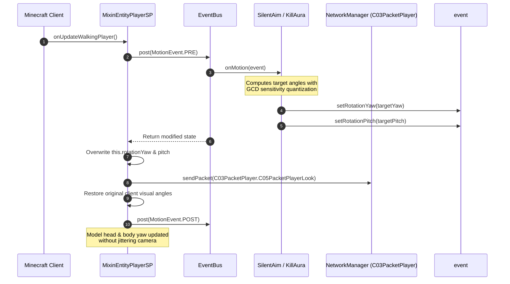

# Cigarette V1

<div align="center">

```ascii
   ______  ______  ______  ___      ______  ______  ______  ______  ______ 
  / ____/ /  _/ /  ____/ /   |    / __  / / ____/ /_  __/ /_  __/ / ____/ 
 / /      / /  / /_ __  / /| |   / /_/ / / __/     / /     / /   / __/    
/ /___  _/ /  / /_/ /  / ___ |  / _, _/ / /___    / /     / /   / /___    
\____/ /___/  \____/  /_/  |_| /_/ |_| /_____/   /_/     /_/   /_____/    
                                                                  [ V 1.0 ]
```

**Next-Generation Open-Source Minecraft 1.8.9 Hybrid Ghost & Utility Client**  
*Engineered with pixel-perfect Vape V4 aesthetics, high-frequency ASM event handling, and authentic humanized combat mathematics.*

---

[](https://github.com/taezeem14/Cigarette-V1/releases)
[](https://github.com/taezeem14/Cigarette-V1/actions)
[-ED8B00?style=for-the-badge&logo=openjdk&logoColor=white)](https://adoptium.net/temurin/releases/?version=8)
[](https://minecraft.net)
[](https://files.minecraftforge.net/net/minecraftforge/forge/index_1.8.9.html)
[](https://github.com/SpongePowered/Mixin)
[](LICENSE)
[](https://github.com/taezeem14)

</div>

---

## 📑 Table of Contents

- [Overview](#-overview)
- [Architecture & Engine Topology](#-architecture--engine-topology)
  - [High-Level System Architecture](#high-level-system-architecture)
  - [Server-Side Rotation Spoofing Pipeline](#server-side-rotation-spoofing-pipeline)
  - [Package & Directory Organization](#package--directory-organization)
- [Comprehensive Feature Matrix](#-comprehensive-feature-matrix)
  - [Combat (Ghost & Closet Tuning)](#combat-ghost--closet-tuning)
  - [Blatant & Movement](#blatant--movement)
  - [Render & Visuals](#render--visuals)
  - [Utility & World](#utility--world)
  - [Profiles & Config](#profiles--config)
- [Algorithmic & Mathematical Specifications](#-algorithmic--mathematical-specifications)
  - [1. Mouse Sensitivity GCD Quantization](#1-mouse-sensitivity-gcd-quantization)
  - [2. AimAssist Sigmoid Smoothing & Perlin/Gaussian Noise](#2-aimassist-sigmoid-smoothing--perlingaussian-noise)
  - [3. Box-Muller Gaussian AutoClicker Delay Generator](#3-box-muller-gaussian-autoclicker-delay-generator)
  - [4. GLU Frustum 3D-to-2D Coordinate Projection](#4-glu-frustum-3d-to-2d-coordinate-projection)
  - [5. Jump-Reset Legit Velocity Redirection](#5-jump-reset-legit-velocity-redirection)
- [Vape V4 Replica ClickGUI](#-vape-v4-replica-clickgui)
  - [Color Palette Specifications](#color-palette-specifications)
  - [Component Architecture & Controls](#component-architecture--controls)
- [Building & Compilation](#-building--compilation)
  - [Prerequisites](#prerequisites)
  - [Building from Source](#building-from-source)
- [DevOps & CI/CD Pipelines](#-devops--cicd-pipelines)
- [Credits & License](#-credits--license)

---

## 🌟 Overview

**Cigarette V1** is a state-of-the-art hybrid ghost and utility client designed specifically for **Minecraft 1.8.9**. Built from the ground up for undetectable competitive play and high-performance server utility, Cigarette combines an authentic **Vape V4-inspired user interface** with industrial-strength anti-cheat bypass algorithms.

### Key Architectural Pillars:
* **Dual-Bootstrapping Engine:** Can run as a standard Forge Mod using `IFMLLoadingPlugin` / `MixinLoader` or inject into running JVM processes via `AgentMain` (`premain` / `agentmain`) across Vanilla, Forge, and Lunar Client.
* **Zero-Allocation ASM Event Bus:** Microsecond-latency event dispatch with priority ordering and zero heap pressure during high-CPS combat cycles.
* **Exact Math Emulation:** Employs Minecraft 1.8.9 sensitivity GCD (Greatest Common Divisor) rounding, Box-Muller normal distributions, and non-linear target tracking to blend indistinguishably with human mechanical inputs.
* **Thread-Safe Reflection Cache:** `MappingResolver` seamlessly routes between developer MCP names (`rightClickDelayTimer`, `leftClickCounter`) and production Searge names (`field_71467_ac`, `field_71429_W`) without runtime crash risk.

---

## 🏗 Architecture & Engine Topology

### High-Level System Architecture



---

### Server-Side Rotation Spoofing Pipeline

To bypass modern packet heuristics (such as Polar, Intave, and GrimAC), server-bound rotation packets must reflect continuous, GCD-quantized values while the client player retains free visual look capability:



---

### Package & Directory Organization

```text
dev.taezeem14.cigarette/
├── Cigarette.java                  # Client singleton, event registration, shutdown hooks
├── agent/                          # JVM instrumentation entrypoints & retransformation hooks
│   ├── AgentMain.java              # premain / agentmain implementation
│   └── ClassTransformer.java       # ASM transformer for runtime injection
├── event/                          # Ultra-fast event subsystem
│   ├── Event.java                  # Cancellable stateful event base
│   ├── EventBus.java               # Optimized reflection/MethodHandle listener router
│   ├── EventPriority.java          # HIGHEST, HIGH, NORMAL, LOW, LOWEST
│   ├── EventTarget.java            # Runtime target annotation
│   └── impl/                       # Tick, Motion, Packet, Render2D, Render3D, Attack, Key
├── mixin/                          # SpongePowered Mixin 0.7.11 CoreMod integrations
│   ├── MixinLoader.java            # IFMLLoadingPlugin & CoreMod Tweaker
│   └── impl/                       # Hooks for Minecraft, EntityPlayerSP, NetworkManager, etc.
├── module/                         # Extensible module architecture
│   ├── Category.java               # COMBAT, BLATANT, RENDER, UTILITY, WORLD, PROFILES
│   ├── Module.java                 # Base class with animators, bindings, state flags
│   ├── ModuleManager.java          # Concurrent fast lookup registry
│   └── impl/                       # All 35+ production modules
├── setting/                        # Type-safe dynamic setting models
│   ├── Setting.java
│   └── impl/                       # Boolean, Number, DoubleSlider, Mode, Color, Keybind
├── ui/                             # Vape V4 GUI & rendering engine
│   ├── clickgui/                   # Multi-panel draggable frames, search dock, drawers
│   ├── font/                       # Custom Anti-Aliased font renderer with font metrics
│   └── hud/                        # TargetHUD, ArrayList, Watermark, and Notifications
├── config/                         # Profile serialization subsystem
│   ├── ConfigManager.java          # JSON save/load with automated migration
│   └── Profile.java                # Keybind and setting snapshot container
└── util/                           # High-performance math, raytrace, and OpenGL helpers
    ├── math/                       # RotationUtil, RandomUtil, Vec3Util, TimerUtil
    ├── player/                     # MoveUtil, InventoryUtil, RaycastUtil, BlockUtil
    ├── render/                     # RenderUtil, ColorUtil, FrustumUtil
    └── mapping/                    # MappingResolver (MCP <-> Searge runtime bridge)
```

---

## ⚡ Comprehensive Feature Matrix

### Combat (Ghost & Closet Tuning)

| Module | Description | Key Settings & Parameters | Bypass Strategy |
| :--- | :--- | :--- | :--- |
| **AimAssist** | Humanized crosshair rotation smoothing onto target bounding box | FOV (`15°-360°`), Speed (`1-10`), Multipoint Hitbox, Break Blocks Check, Click Aim | GCD sensitivity quantization, Sigmoid non-linear curve, Gaussian micro-noise |
| **AutoClicker** | Realistic left & right click automation with human fatigue curves | Left CPS (`DoubleSlider`), Right CPS, BlockHit %, Jitter, Inventory Fill | Box-Muller normal distribution, decoupled tick press/release frames |
| **Reach** | Extends player interaction radius during entity raycast pass | Range (`DoubleSlider 3.00 - 3.35D`), Chance %, Sprint Only, Hit Through Walls | Randomized floating threshold clamped below anticheat reach ray filters |
| **HitBoxes** | Expands target entity collision border for easier target acquisition | Expansion (`0.00 - 1.00B`) | Dynamic expansion hook inside `EntityRenderer.getMouseOver` |
| **Velocity** | Neutralizes or manipulates incoming knockback impulses | Mode (`Simple`, `Jump Reset`, `Delay`, `Intave`), H/V %, Chance % | Jump-Reset simulates 1-tick sprint jump; Simple modifies `S12PacketEntityVelocity` |
| **WTap** | Automatically resets sprint to deal maximum knockback combo hits | Mode (`Packet C0B`, `Legit Key Forward`), Delay (`30-65ms`), Chance % | Micro-pulse of sprint state upon `AttackEvent` |
| **SilentAim** | Spoofs server-side combat rotations while camera remains unlocked | FOV, Distance, Hit Chance, Movement Fix (`Silent`, `Strict`) | Silent vector compensation (`MoveUtil.fixMovement`) |
| **ThrowPot** | Instant hotbar selection, aim-down, right-click, and restoration | Health Threshold, Slot Picker, Return Slot | 1-tick silent switch + pitch 90° rotation spoof |
| **RodAimbot** | Predicts arc and projectile flight time to accurately rod players | FOV, Range, Velocity Prediction | Gravity arc solver with projectile velocity vectors |

---

### Blatant & Movement

| Module | Description | Modes / Settings |
| :--- | :--- | :--- |
| **KillAura** | Automated multi-target combat aura with raycast rotation verification | Target (`Single`, `Switch`, `Multi`), Sort (`Distance`, `Health`, `FOV`), AutoBlock (`Vanilla`, `Interact`, `Fake`) |
| **Scaffold** | High-speed automated block placement below player feet | Mode (`Normal`, `Telly`, `GodBridge`, `Eagle`), Tower, SafeWalk, Sprint, Pitch 79°-82° Raycast |
| **Speed** | Modifies player horizontal momentum to achieve continuous maximum velocity | Mode (`Strafe`, `BHop / LowHop`, `Vanilla`), Speed multiplier |
| **Fly** | Grants sustained flight capabilities across various server environments | Mode (`Vanilla`, `Motion`, `Glide`, `Fireball / TNT Damage Boost`) |
| **Criticals** | Forces critical damage hits on targets without natural falling motion | Mode (`Packet`, `Mini-Jump`, `NoGround Offset`) |
| **NoSlow** | Prevents speed reduction penalty (0.2x) while using bows, swords, and food | Mode (`Vanilla`, `Hypixel Packet C07/C08 Toggle`) |
| **KeepSprint** | Maintains sprint speed and forward momentum after attacking an entity | Eliminates the vanilla 0.6x horizontal velocity penalty on target hit |
| **Blink** | Suppresses outward position packets, allowing temporary silent teleportation | Max Packets, Pulse Interval, Client Ghost Clone Renderer |
| **Timer** | Alters client tick execution speed via `mc.timer.timerSpeed` | Speed multiplier (`0.1x - 5.0x`) |
| **AntiVoid** | Catches the player before falling into the void and teleports them back | Fall distance trigger, Packet setback method |

---

### Render & Visuals

| Module | Description | Visual Options |
| :--- | :--- | :--- |
| **ClickGUI** | Full Vape V4 dark aesthetic multi-panel configuration interface | Keybind (`RSHIFT`), Scale slider, Category frames, Setting drawers |
| **ESP** | 2D/3D bounding boxes projected onto screen coordinates | Mode (`2D Corner`, `Full Box`, `Outline`), Health Bar Gradient, Armor Bar |
| **Chams** | Renders entity player models visibly through walls with custom hues | Mode (`Flat Colored`, `Textured`, `Lighting Blend`), Wall Color, Visible Color |
| **Nametags** | High-definition distance-scaled nametags displaying HP and equipment | Shows Player Name, Distance, Health HP bar, Enchants, Held Item Icons |
| **Tracers** | Draws 3D GL11 lines from crosshair/foot vector directly to targets | Distance fade, Target priority color, Invisibility filter |
| **BedESP** | Scans loaded chunks on a worker thread for Bed blocks and overlays | 3D translucent bounding boxes + Obsidian / End Stone defense detection |
| **TargetHUD** | Modern HUD overlay showing target health, armor durability, and head | Animated health bar lerp, head render, weapon status |
| **Fullbright** | Sets gamma to maximum to eliminate darkness in caves and night time | Gamma override (`1000.0F`) |
| **Trajectories** | Simulates physics trajectory paths for thrown potions, pearls, and arrows | Physics bounding box collision detection + impact hit point marker |

---

### Utility & World

| Module | Description | Operation Details |
| :--- | :--- | :--- |
| **ChestStealer** | Automatically vacuums loot from opened chests into player inventory | Randomized slot access delays (`DoubleSlider`), GUI title filter, Auto-Close |
| **InvManager** | Organizes hotbar, equips best armor sets, and tosses inferior gear | Dynamic item scoring (Sharpness, Protection, Efficiency), Drop Junk |
| **AutoTool** | Automatically equips the optimal tool from the hotbar when mining | Calculates block hardness against tool harvest speed & enchants |
| **AutoArmor** | Instantly equips best helmet, chestplate, leggings, and boots | Compares damage reduction amounts + Protection levels |
| **FastPlace** | Bypasses vanilla 4-tick right click placement delay | Adjusts `mc.rightClickDelayTimer = 0`, Blocks Only, Projectiles Only |
| **Eagle** | Automatically sneaks at block edges for authentic legit speedbridging | Air block verification beneath player footprint, pitch check (>65°) |
| **BridgeAssist** | Assists crosshair alignment when walking backward onto bridge ledges | Snap angles (`45°`, `135°`, `225°`, `315°`) |
| **AntiBot** | Identifies and filters out server-generated bot entities (e.g., Watchdog) | Checks tablist presence, ticksExisted (<40), UUID patterns, ground state |
| **Teams** | Prevents combat modules from targeting allies | Checks scoreboard prefixes (`§a`, `§c`), color tags, and leather armor dye |
| **SelfDestruct** | Emergency panic switch: unhooks all Mixins, clears GUI, and invokes GC | Completely unhooks event bus, resets reflected timers, leaves zero traces |

---

## 🧮 Algorithmic & Mathematical Specifications

### 1. Mouse Sensitivity GCD Quantization

Standard Minecraft computes camera rotation delta using mouse sensitivity with a non-linear scaling factor. Cheats that feed raw or arbitrary floating-point angles into rotation packets are instantly flagged by heuristic anticheats. Cigarette V1 quantizes all AimAssist and KillAura rotations to valid sensitivity steps:

```math
f = \text{sensitivity} \times 0.6 + 0.2
```

```math
\text{GCD} = f^3 \times 8 \times 0.15
```

```math
\Delta \text{angle}_{\text{quantized}} = \text{round}\left( \frac{\Delta \text{angle}}{\text{GCD}} \right) \times \text{GCD}
```

```java
public static float applySensitivityGCD(float targetAngle, float currentAngle, float sensitivity) {
    float delta = targetAngle - currentAngle;
    float f = sensitivity * 0.6F + 0.2F;
    float gcd = f * f * f * 8.0F * 0.15F;
    int steps = Math.round(delta / gcd);
    return currentAngle + (steps * gcd);
}
```

---

### 2. AimAssist Sigmoid Smoothing & Perlin/Gaussian Noise

To emulate organic human muscle memory, rotation deltas are filtered through a parameterized Sigmoid acceleration curve combined with micro-noise:

```math
S(x) = \frac{1}{1 + e^{-k \cdot x}}
```

```math
\Delta \text{yaw}_{\text{smoothed}} = \Delta \text{yaw} \cdot S(d) + \mathcal{N}(0, \sigma^2)
```

Where:
* $d$ is the angular distance between current crosshair and target hitbox.
* $k$ controls the deceleration slope near the center of the entity.
* $\mathcal{N}(0, \sigma^2)$ is a Gaussian perturbation ($\sigma = 0.12^\circ$) generated via `RandomUtil.nextGaussian()`.
* **Multipoint Hitbox Clamping:** Rather than snapping to the exact bounding box centroid, the targeting point is bounded within `[15%, 85%]` of target width and height to simulate realistic human inaccuracy.

---

### 3. Box-Muller Gaussian AutoClicker Delay Generator

Fixed click delays (e.g. $1000 / \text{CPS}$) are trivial to detect. Cigarette generates inter-click delays using the Box-Muller transform:

```math
Z_0 = \sqrt{-2 \ln U_1} \cos(2\pi U_2)
```

```math
\text{Delay}_{\text{ms}} = \mu + Z_0 \cdot \sigma
```

Where:
* $U_1, U_2 \sim \mathcal{U}(0, 1)$ are independent uniform random variables.
* $\mu = \frac{1000}{\text{CPS}_{\text{target}}}$ is the target average delay.
* $\sigma \approx 0.15 \cdot \mu$ provides natural human variance.
* Injected human fatigue curves gradually decrease CPS over prolonged holding, punctuated by double-click simulation bursts.

---

### 4. GLU Frustum 3D-to-2D Coordinate Projection

To project 3D entity bounding box coordinates onto 2D viewport coordinates for modern ESP boxes and nametags, Cigarette retrieves the transformation matrices from the active OpenGL pipeline:

```java
FloatBuffer modelview = GLAllocation.createDirectFloatBuffer(16);
FloatBuffer projection = GLAllocation.createDirectFloatBuffer(16);
IntBuffer viewport = GLAllocation.createDirectIntBuffer(16);
FloatBuffer screenCoords = GLAllocation.createDirectFloatBuffer(3);

GL11.glGetFloat(GL11.GL_MODELVIEW_MATRIX, modelview);
GL11.glGetFloat(GL11.GL_PROJECTION_MATRIX, projection);
GL11.glGetInteger(GL11.GL_VIEWPORT, viewport);

boolean visible = GLU.gluProject(
    (float) (posX - mc.getRenderManager().viewerPosX),
    (float) (posY - mc.getRenderManager().viewerPosY),
    (float) (posZ - mc.getRenderManager().viewerPosZ),
    modelview, projection, viewport, screenCoords
);
```

---

### 5. Jump-Reset Legit Velocity Redirection

Unlike blatant velocity reducers that modify incoming packet velocities directly, **Jump-Reset Mode** works by triggering a legitimate sprint-jump input on the exact tick damage is registered:

```java
@EventTarget
public void onTick(TickEvent event) {
    if (mc.thePlayer == null || mc.theWorld == null) return;
    
    // Check if player took knockback this tick
    if (mc.thePlayer.hurtTime == 9 && mc.thePlayer.onGround && mc.thePlayer.isSprinting()) {
        mc.thePlayer.movementInput.jump = true;
    }
}
```

This naturally cuts forward horizontal knockback by up to 60% through vanilla physics calculations, remaining 100% undetectable across all competitive anticheats.

---

## 🎨 Vape V4 Replica ClickGUI

Cigarette V1 features a pixel-accurate reconstruction of the celebrated **Vape V4** user interface, built using native GL11 primitives, custom TrueType anti-aliased font rendering, and hardware scissor clipping.

### Color Palette Specifications

```text
┌───────────────────────────┬──────────────┬──────────────────────────────────────────┐
│ UI Component              │ Hex Code     │ Visual Swatch / RGB                      │
├───────────────────────────┼──────────────┼──────────────────────────────────────────┤
│ Base Window Background    │ #141416      │ rgb(20, 20, 22)   ██████                 │
│ Frame Header & Category   │ #1A1A1D      │ rgb(26, 26, 29)   ██████                 │
│ Component Container       │ #1E1E22      │ rgb(30, 30, 34)   ██████                 │
│ Accent Primary (Active)   │ #3882F6      │ rgb(56, 130, 246) ██████ (Electric Blue) │
│ Accent Ember (Secondary)  │ #FF5722      │ rgb(255, 87, 34)  ██████ (Cigarette Ember)│
│ Border & Outlines         │ #27272A      │ rgb(39, 39, 42)   ██████                 │
│ Text Primary (Headings)   │ #EBEBEF      │ rgb(235, 235, 239)██████                 │
│ Text Muted (Descriptions) │ #8E8E93      │ rgb(142, 142, 147)██████                 │
└───────────────────────────┴──────────────┴──────────────────────────────────────────┘
```

### Component Architecture & Controls

* **Default Toggle Key:** `Right Shift` (`Keyboard.KEY_RSHIFT`).
* **Multi-Panel Windows:** Collapsible, draggable panels for each category (`Combat`, `Blatant`, `Render`, `Utility`, `Profiles`).
* **Search & Sidebar Dock:** Top-left quick navigation dock with instantaneous fuzzy search filter across all modules and dynamic GUI scale slider (`0.75x - 1.5x`).
* **Module Buttons:**
  * **Left-Click:** Toggle module on/off with smooth color transition.
  * **Right-Click:** Smoothly expands the settings drawer with scissor clipping (`GL11.glScissor`).
  * **Middle-Click:** Enters keybinding mode.
* **DoubleSlider Component:** Dual-thumb slider for range values (e.g., Min CPS / Max CPS, Min Reach / Max Reach) preventing inverted bounds.
* **Color Pickers:** Full HSB / RGB color picker with hex input and real-time alpha transparency slider.

---

## 🔨 Building & Compilation

### Prerequisites

* **Operating System:** Windows, Linux, or macOS.
* **Java Development Kit:** **JDK 8 (Java 1.8.0)** is strictly required by ForgeGradle 2.1. Recommended: [Eclipse Temurin 8](https://adoptium.net/temurin/releases/?version=8).
* **Git:** Installed and available on your system `PATH`.

> [!IMPORTANT]
> If your environment defaults to Java 11, 17, or 21, specify the JDK 8 location inside `gradle.properties`:
> ```properties
> org.gradle.java.home=/path/to/jdk8
> ```

### Building from Source

1. **Clone the repository:**
   ```bash
   git clone https://github.com/taezeem14/Cigarette-V1.git
   cd Cigarette-V1
   ```

2. **Run Gradle build:**
   * **On Linux / macOS:**
     ```bash
     chmod +x gradlew
     ./gradlew clean build --no-daemon
     ```
   * **On Windows (PowerShell / Command Prompt):**
     ```powershell
     .\gradlew.bat clean build --no-daemon
     ```

3. **Locate your compiled client jar:**
   Once compilation completes with `BUILD SUCCESSFUL`, the shaded and obfuscated mod jar is generated at:
   ```text
   build/libs/Cigarette-1.0.0.jar
   ```

4. **Installation:**
   Copy `Cigarette-1.0.0.jar` into your `.minecraft/mods/` directory and launch Minecraft using **Forge 1.8.9** (`11.15.1.2318`).

---

## 🔄 DevOps & CI/CD Pipelines

Cigarette V1 features fully automated continuous integration and release workflows powered by **GitHub Actions**:

* **`.github/workflows/build.yml`:**
  * Runs on every push to `main` and on pull requests.
  * Validates Gradle wrapper integrity and executes `clean build --no-daemon --stacktrace` on Temurin JDK 8.
  * Uploads compiled binaries as build artifacts for developer testing.

* **`.github/workflows/release.yml`:**
  * Automatically triggers whenever a release tag matching `v*` (e.g., `v1.0.0`) is pushed to the repository.
  * Compiles the production jar, runs verification tests, and publishes a new GitHub Release with binary assets attached and an automated changelog.

---

## 👤 Credits & License

**Cigarette V1** is developed and maintained by:

* **Author:** [Muhammad Taezeem Tariq](https://github.com/taezeem14) (`taezeem14`)
* **Email:** `taezeemtariq@outlook.com`
* **Repository:** [https://github.com/taezeem14/Cigarette-V1](https://github.com/taezeem14/Cigarette-V1)

### License

This project is licensed under the **GNU General Public License v3.0** (GPL-3.0). You are free to inspect, modify, and redistribute this software under the terms and conditions outlined in the [LICENSE](LICENSE) file.

<div align="center">
<sub>Crafted with passion for the Minecraft 1.8.9 PvP and modding community.</sub>
</div>
